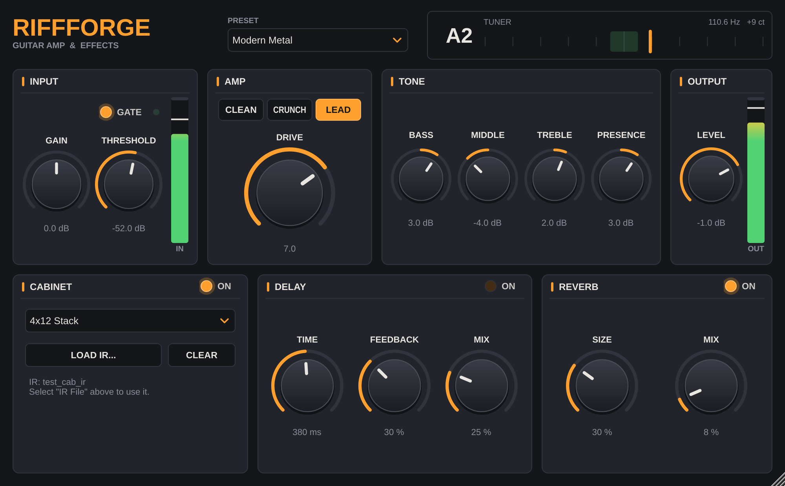

# RiffForge — гитарный усилитель и эффекты

RiffForge — это симулятор гитарного усилителя с эффектами. Он работает в двух видах:

* **Отдельное приложение (Standalone).** Подключаете гитару в аудиокарту и играете через RiffForge, DAW не нужна.
* **Плагин** для DAW (Reaper, Cubase, Ableton Live, FL Studio, Studio One, Bitwig, Ardour, Logic и др.): **VST3** (Windows, macOS, Linux), **AU** (macOS) и **LV2** (Linux).



## Цепочка обработки

```
Гитара → Input Gain → Noise Gate → Усилитель (Clean / Crunch / Lead, 4× оверсэмплинг)
       → Bass / Middle / Treble / Presence → Кабинет (1x12, 4x12 или ваш IR-файл)
       → Delay → Reverb → Output Level → выход аудиокарты / DAW
```

| Блок | Ручки | Что делает |
|------|-------|------------|
| **INPUT** | Gain, Gate, Threshold | Уровень входа и шумодав с гистерезисом. Зелёный светодиод горит, когда гейт открыт. Измеритель IN показывает уровень с гитары. |
| **AMP** | Clean / Crunch / Lead, Drive | Три канала: Clean (чистый, лёгкий перегруз на максимуме), Crunch (классический рок), Lead (два каскада, хай-гейн). Нелинейная часть работает с 4× оверсэмплингом, поэтому нет алиасинга («песка»). Громкость при повороте Drive автоматически выравнивается. |
| **TONE** | Bass, Middle, Treble, Presence | Тонблок ±12 дБ. |
| **CABINET** | On, модель, Load IR / Clear | Встроенные кабинеты *1x12 Combo* (открытый) и *4x12 Stack* (закрытый) или загрузка своего импульса (IR) в WAV/AIFF/FLAC. IR сохраняется внутри проекта или пресета, так что проект откроется и на другом компьютере. |
| **DELAY** | On, Time, Feedback, Mix | Аналоговый по характеру дилей: повторы темнеют и мягко насыщаются, при выключении хвосты доигрывают. |
| **REVERB** | On, Size, Mix | Стерео-ревербератор. |
| **OUTPUT** | Level | Общая громкость и измеритель OUT. Если наверху измерителя загорается красная полоска, был клиппинг (щелчок по измерителю сбрасывает индикатор). |
| **TUNER** | — | Хроматический тюнер в шапке: нота, частота, отклонение в центах. Работает от 55 Гц, так что подходит для пониженных строев и 7-струнных гитар. |

Встроенные пресеты: *Init, Clean Sparkle, Blues Crunch, Classic Rock, Modern Metal, Lead Solo, Ambient Clean*.
Двойной щелчок по ручке возвращает её значение по умолчанию. Окно плагина можно растягивать за правый нижний угол.

## Подключение гитары к аудиокарте

1. Включите гитару в **инструментальный вход** аудиокарты: **Hi-Z / INST / Guitar**. Обычный линейный вход тоже работает, но звучит тусклее.
2. Выставьте **gain на самой аудиокарте** так, чтобы при самой сильной игре измеритель **IN** в RiffForge доходил примерно до -12…-6 dB, а индикатор клиппинга на аудиокарте не загорался.
3. Используйте **наушники** или мониторы. Встроенный микрофон ноутбука лучше отключить, иначе возможна обратная связь.
4. Чтобы задержка была незаметной, поставьте **буфер 64–128 сэмплов** (при 48 кГц это примерно 1,5–3 мс на буфер). Если слышны щелчки, увеличьте буфер.

### Отдельное приложение (Standalone)

1. Запустите RiffForge (Windows: `RiffForge.exe`, macOS: `RiffForge.app`, Linux: `RiffForge`).
2. Нажмите **Options → Audio/MIDI Settings...**:
   * **Audio device type**: на Windows выберите **ASIO**, если сборка с ASIO и драйвер аудиокарты его поддерживает. Иначе выберите **Windows Audio (Low Latency Mode)** или **Windows Audio (Exclusive Mode)**. На macOS используется CoreAudio, на Linux ALSA или JACK.
   * **Input**: выберите вход, к которому подключена гитара (например, *Input 1* или *Input 2*).
   * **Output**: выход на наушники или мониторы.
   * **Buffer size**: 64–128.
   * Снимите галочку **Mute audio input**. По умолчанию JUCE глушит вход, чтобы не было обратной связи через микрофон, и показывает жёлтую плашку *«Audio input is muted to avoid feedback loop»*.
3. Играйте. Через *Options → Save current state... / Load a saved state...* можно сохранять и загружать свои настройки в файл.

### В DAW

1. Создайте **моно**-аудиодорожку, назначьте ей вход аудиокарты с гитарой и включите **мониторинг входа** (record arm / monitor).
2. Вставьте **RiffForge** в эффекты дорожки (категория *Fx / Distortion*).
   Если DAW даёт только стереодорожки (например, Ableton или FL Studio), выберите на входе один канал с гитарой (*1*, а не *1/2*). RiffForge усредняет левый и правый каналы, поэтому сигнал, который пришёл только в один из них, станет на 6 дБ тише.
3. Записывать лучше «чистый» сигнал гитары, а RiffForge оставить эффектом на дорожке. Так звук можно поменять уже после записи.

## Готовые сборки

В репозитории есть GitHub Actions (`.github/workflows/build.yml`). После `git push` на GitHub сборка запускается автоматически для **Windows, macOS и Linux**: собираются все форматы, проходят тесты, а готовые архивы `RiffForge-Windows.zip`, `RiffForge-macOS.zip` и `RiffForge-Linux.zip` появляются во вкладке **Actions → нужный запуск → Artifacts**.

Сборка для Windows пытается скачать ASIO SDK с сайта Steinberg. Если это получилось, в standalone-приложении будет ASIO. Если нет, будет WASAPI.

## Установка плагина

Скопируйте файлы в стандартные папки:

| Система | VST3 | Другое |
|---------|------|--------|
| Windows | `C:\Program Files\Common Files\VST3\RiffForge.vst3` | `RiffForge.exe` можно положить в любую папку |
| macOS | `~/Library/Audio/Plug-Ins/VST3/RiffForge.vst3` | AU: `~/Library/Audio/Plug-Ins/Components/RiffForge.component` |
| Linux | `~/.vst3/RiffForge.vst3` | LV2: `~/.lv2/RiffForge.lv2` |

После копирования пересканируйте плагины в DAW.

> **macOS:** сборки не подписаны сертификатом Apple. Если система не даёт их запустить, выполните
> `xattr -dr com.apple.quarantine ~/Library/Audio/Plug-Ins/VST3/RiffForge.vst3`
> (так же для `.component` и `.app`).

## Сборка из исходников

Нужны **CMake ≥ 3.22**, компилятор C++17 и Git. JUCE 8.0.12 скачивается автоматически при первой настройке.

**Windows** (Visual Studio 2022 с компонентом «Разработка классических приложений на C++»):

```bash
cmake -S . -B build
```

```bash
cmake --build build --config Release
```

Чтобы в standalone-приложении был ASIO, скачайте [ASIO SDK](https://www.steinberg.net/developers/), распакуйте его и укажите путь к папке, внутри которой лежит `common/asio.h`:

```bash
cmake -S . -B build -DRIFFFORGE_ASIO_SDK_DIR=C:/SDKs/asiosdk
```

**macOS** (Xcode Command Line Tools):

```bash
cmake -S . -B build -DCMAKE_BUILD_TYPE=Release
```

```bash
cmake --build build -j8
```

**Linux** (Debian/Ubuntu):

```bash
sudo apt install build-essential cmake git libasound2-dev libjack-jackd2-dev libfreetype-dev libfontconfig1-dev libx11-dev libxcomposite-dev libxcursor-dev libxext-dev libxinerama-dev libxrandr-dev libxrender-dev libgl1-mesa-dev
```

```bash
cmake -S . -B build -DCMAKE_BUILD_TYPE=Release
```

```bash
cmake --build build -j8
```

Результат лежит в `build/RiffForge_artefacts/Release/` (папки `VST3`, `Standalone`, `AU` или `LV2`).
Если добавить `-DRIFFFORGE_COPY_AFTER_BUILD=ON`, плагины после сборки сами скопируются в системные папки (на Windows для этого нужны права администратора).
Если JUCE уже скачан, его можно подключить так: `-DFETCHCONTENT_SOURCE_DIR_JUCE=/путь/к/JUCE`.

## Тесты

В проекте два теста, оба собираются вместе с плагином:

* `RiffForgeRenderTest [папка]` прогоняет синтетическую гитару через все пресеты и сохраняет WAV-файлы. Он проверяет, что на выходе нет NaN/Inf, клиппинга и тишины, что гейт глушит шум, что пресеты и IR выровнены по громкости и что состояние (вместе со встроенным IR) переживает сохранение и загрузку. Ещё он проверяет тюнер на всех открытых струнах, нагрузку на процессор и сохраняет скриншот интерфейса.
* `RiffForgeHostTest <плагин>` загружает собранный `.vst3` или `.lv2` так же, как это делает DAW, и проверяет раскладки каналов, параметры, пресеты, обработку при 44,1/48/96 кГц и разных размерах буфера, сохранение состояния и открытие окна.

```bash
./build/RiffForgeRenderTest_artefacts/Release/RiffForgeRenderTest render-output
```

```bash
./build/RiffForgeHostTest_artefacts/Release/RiffForgeHostTest build/RiffForge_artefacts/Release/VST3/RiffForge.vst3
```

Последние результаты на Linux: все проверки пройдены, нагрузка около 3–4 % одного ядра (Lead + IR + Delay + Reverb), задержка 6 сэмплов (0,125 мс при 48 кГц).

## Структура проекта

```
Source/
  PluginProcessor.*     обработка звука, пресеты, сохранение состояния, загрузка IR
  PluginEditor.*        интерфейс
  Parameters.h          все параметры (ID не менять: они хранятся в проектах DAW)
  Presets.h             заводские пресеты
  dsp/                  NoiseGate, AmpStage, ToneStack, CabSimulator, Delay, PitchDetector
  gui/                  LookAndFeel и виджеты (ручки, измерители, тюнер)
tests/                  RenderTest.cpp, HostTest.cpp
.github/workflows/      сборка для Windows / macOS / Linux
```

## Лицензия

Проект основан на фреймворке [JUCE](https://juce.com), который распространяется по лицензии **AGPLv3** или по коммерческой лицензии JUCE. Если вы распространяете RiffForge, используя бесплатный вариант JUCE, исходный код тоже должен быть открыт под AGPLv3. Для закрытого коммерческого продукта нужна лицензия JUCE. ASIO SDK от Steinberg распространяется по собственной лицензии Steinberg или по GPLv3.
